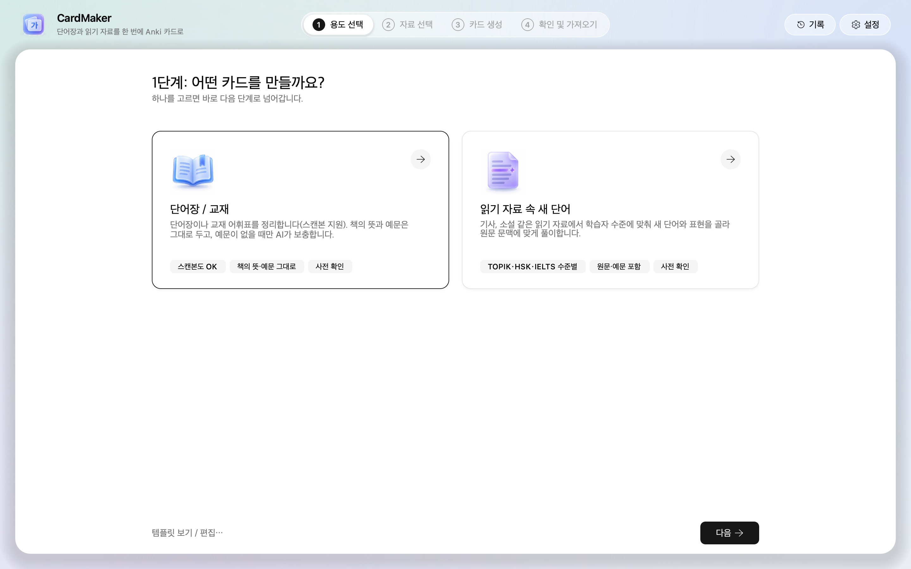
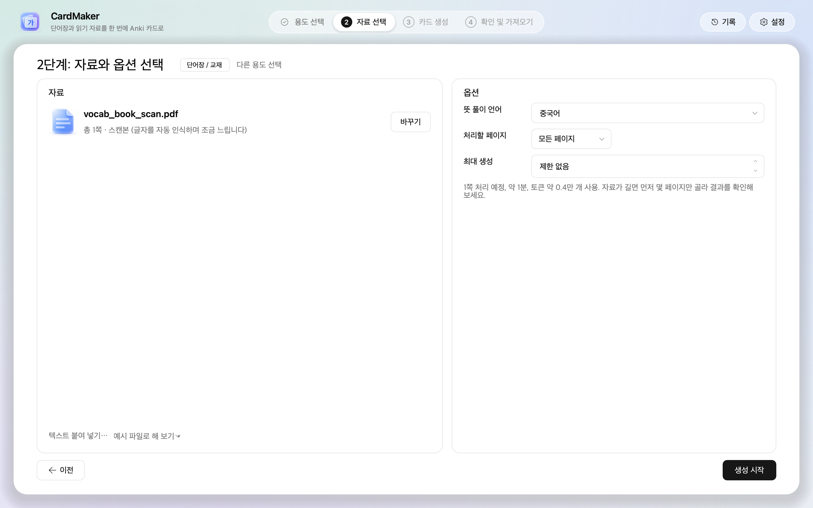
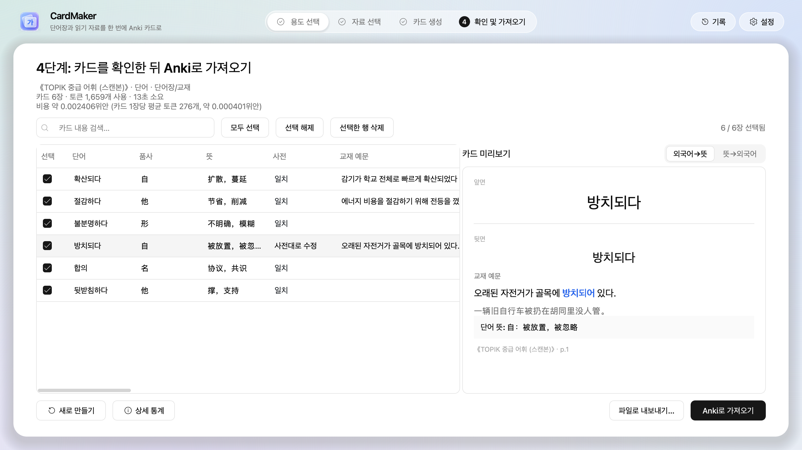

# CardMaker

**PDF · 스캔본 단어장 → Anki 학습 카드 자동 생성 데스크톱 앱**  
**PDF / 扫描件单词书 → Anki 学习卡片自动生成桌面应用**

[한국어](#한국어) · [中文](#中文)

---

<a id="한국어"></a>
## 한국어

### 소개
**CardMaker**는 PDF(텍스트 PDF·스캔본 단어장·읽기 자료)에서 단어를 추출하고, **사전 대조 검증**을 거친 뒤 **Anki 학습 카드**로 만들어 주는 Python + PySide6 데스크톱 프로그램입니다.  
(한국교통대학교 소프트웨어전공 졸업작품 · 2544412 유지원 / LIU ZHIYUAN)

> **심사 후 직접 수정 기록 (`ai-baseline` 이후)**  
> 11월 12일 면담 이후 `liu/after-review` 브랜치에서 Windows 호환(`os.getuid`, 권한 테스트, 시스템 음성), 오프라인 사전 3종(한국어 위키낱말사전·ECDICT·PanLex) 클라이언트, 뜻 비교·오탐 방지·손글씨 버그 수정을 직접 작성하고 검증했습니다. AI가 작성한 테스트·스크립트·설정 커밋에는 모두 `(AI)` 또는 `(AI 협업)`을 표시했습니다.

### 화면 미리보기

| 1단계 · 용도 선택 | 2단계 · 자료 및 옵션 선택 |
| :---: | :---: |
|  |  |

| 4단계 · 사전 확인 및 Anki 가져오기 | Anki 카드 미리보기 (발음 포함) |
| :---: | :---: |
|  |  |

### 주요 기능
- **텍스트 추출 + OCR**: 텍스트 층이 있으면 바로 읽고, 스캔본은 로컬 OCR(Qota-OCR / RapidOCR) 또는 설정에서 멀티모달 LLM API OCR을 선택할 수 있습니다.
- **이중언어 사전 검증 (환각 억제)**: 단어 언어와 뜻 언어(한·영·중 6개 방향)에 따라 사전을 자동 선택합니다.
  - 한국어 단어 → 국립국어원 한국어기초사전(krdict API)
  - 영어 → 중국어: 로컬 **ECDICT** (`ecdict.sqlite`)
  - 영어/중국어 → 한국어: 로컬 **한국어 위키낱말사전** (`kowiktionary.sqlite`) → 없을 시 **PanLex** (`panlex_ko.sqlite`) 보조 검색
  - 중국어 → 영어: 영어판 위키낱말사전
  - 사전 확인을 통과하지 못한 카드는 자동 선택에서 제외되어 사용자가 검토하거나 AI로 다시 인식할 수 있습니다.
- **Windows / macOS 지원**: 시스템 기본 음성 발음(Windows PowerShell `System.Speech` / macOS `say`), 클라우드 TTS, 한국어·중국어·영어 3개 언어 UI를 지원합니다.
- **Anki 연동**: AnkiConnect로 바로 가져오거나 `.apkg` 파일로 내보낼 수 있습니다.

### 설치 및 실행

**요구 사항**: Python 3.11 이상 (Windows / macOS)

```bash
# 1. 가상환경 생성 및 설치
python -m venv .venv

# macOS / Linux
.venv/bin/pip install -e ".[dev]"
.venv/bin/cardmaker-gui

# Windows (PowerShell)
.venv\Scripts\pip install -e ".[dev]"
.venv\Scripts\cardmaker-gui
```

- **테스트 실행 (API Key 불필요, 전체 238개 테스트)**:
  ```bash
  # macOS
  .venv/bin/pytest -m "not slow"   # 빠른 테스트
  .venv/bin/pytest                 # 전체 238개 테스트
  # Windows
  .venv\Scripts\pytest -m "not slow"
  ```
- **로컬 사전 파일 위치**: `ecdict.sqlite`, `kowiktionary.sqlite`, `panlex_ko.sqlite`를 아래 폴더에 넣으면 자동으로 인식합니다.
  - Windows: `%LOCALAPPDATA%\CardMaker\`
  - macOS: `~/Library/Application Support/CardMaker/`
- 설정 파일(`config.yaml`, API Key 포함)은 위 데이터 폴더에 저장되며 Git 저장소에 포함되지 않습니다.

### 사전 데이터 출처 및 라이선스
- **ECDICT**: MIT License (`skywind3000/ECDICT`)
- **한국어 위키낱말사전 (kaikki.org)**: CC BY-SA
- **PanLex**: CC BY-NC-SA 4.0 (비상업적·학술 목적 사용, https://panlex.org/license)

---

<a id="中文"></a>
## 中文

### 项目简介
**CardMaker** 是一个用 Python + PySide6 开发的桌面应用，可以把 PDF（文字版或扫描件单词书、阅读材料）自动整理成 **Anki 学习卡片**，并在导入前通过**词典核对**拦下幻觉和 OCR 错字。  
（本科毕业设计 · 软件专业 2544412 刘志远 / LIU ZHIYUAN）

> **面谈后修改记录（`ai-baseline` 之后）**  
> 11 月 12 日面谈后，在 `liu/after-review` 分支完成了 Windows 适配（`os.getuid`、权限测试、Windows 系统发音）、三本本地离线词典客户端（韩语维基词典、ECDICT、PanLex）、以及实测发现的释义比对与手写材料 bug 修复。AI 协助编写的测试、建库脚本和配置改动均在提交说明中标明了 `(AI)` 或 `(AI 협업)`。

### 核心功能
- **文字提取与 OCR**：PDF 有文字层时直接读取；扫描件支持本地 OCR（Qota-OCR / RapidOCR），也可在设置中切换大模型 API OCR。
- **按语言方向分流的词典核对**：支持中、韩、英三语互学共 6 个方向——韩语词查韩国语基础词典（krdict），英→中查本地 **ECDICT**，英/中→韩先查本地**韩语版维基词典**、查不到再查 **PanLex** 兜底，中→英查英语版维基词典。未通过词典核对的卡片自动取消勾选。
- **跨平台支持（Windows & macOS）**：支持 Windows PowerShell 系统语音与 macOS `say` 发音、云端 TTS，提供韩语 / 中文 / 英语三语界面。
- **一键导入 Anki**：支持通过 AnkiConnect 直接导入（自动配发音与缓存）或导出 `.apkg` 文件。

### 安装与运行

**环境要求**：Python 3.11+（Windows / macOS）

```bash
python -m venv .venv

# macOS / Linux
.venv/bin/pip install -e ".[dev]"
.venv/bin/cardmaker-gui

# Windows (PowerShell)
.venv\Scripts\pip install -e ".[dev]"
.venv\Scripts\cardmaker-gui
```

- **运行测试（无需 API Key，全部 238 个测试）**：
  ```bash
  # macOS
  .venv/bin/pytest -m "not slow"   # 快速测试
  .venv/bin/pytest                 # 全部 238 个测试
  # Windows
  .venv\Scripts\pytest -m "not slow"
  ```
- **本地词典文件目录**：将 `ecdict.sqlite`、`kowiktionary.sqlite`、`panlex_ko.sqlite` 放入以下路径即可自动生效：
  - Windows：`%LOCALAPPDATA%\CardMaker\`
  - macOS：`~/Library/Application Support/CardMaker/`
- 配置文件（`config.yaml`，含 API Key）保存在上述用户数据目录中，不会进入 Git 仓库。
- 也支持命令行（`cardmaker generate / extract / tasks / resume`）及标准库实现的 MCP 服务（`python -m cardmaker.mcp_server`）。
